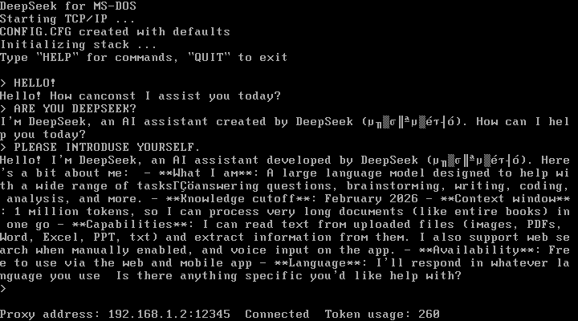

# ds86

通过代理转发 `HTTPS`，在 `MS-DOS` 实体机上用 `mTCP` 实现的 `DeepSeek` 客户端


- **DOS 端**（`DS86.EXE`）只负责处理输入输出、收发纯文本
- **代理端**（`proxy.py`）维护对话上下文、调用 `DeepSeek API`、处理流式响应

## 演示效果



## 目录结构

```
.
├── LICENSE
├── makefile       # wmake 构建脚本
├── README.md
├── src
│   ├── DS86.CFG   # mTCP 编译配置文件
│   ├── DS86.CPP   # 主程序
│   └── proxy.py   # 代理端
└── vendor
    └── mtcp       # mTCP 协议栈
        ├── TCPINC # 头文件
        │   ├── ARP.H
        │   ├── DNS.H
        │   ├── ETH.H
        │   ├── ETHTYPE.H
        │   ├── GLOBAL.CFG
        │   ├── INLINES.H
        │   ├── IP.H
        │   ├── IPTYPE.H
        │   ├── IPV6.H
        │   ├── PACKET.H
        │   ├── RINGBUF.H
        │   ├── SNTPLIB.H
        │   ├── TCP.H
        │   ├── TCPSOCKM.H
        │   ├── TIMER.H
        │   ├── TRACE.H
        │   ├── TYPES.H
        │   ├── UDP.H
        │   └── UTILS.H
        └── TCPLIB # 源文件
            ├── ARP.CPP
            ├── DNS.CPP
            ├── ETH.CPP
            ├── IPASM.ASM
            ├── IP.CPP
            ├── PACKET.CPP
            ├── TCP.CPP
            ├── TCPSOCKM.CPP
            ├── TIMER.CPP
            ├── TRACE.CPP
            ├── UDP.CPP
            └── UTILS.CPP
```

## 架构

```
 MS-DOS
ds86.exe
    │ 明文 TCP（mTCP 协议栈）
    ▼
  局域网
    │
    ▼
  代理机
 proxy.py
    │ HTTPS
    ▼
DeepSeek API
```

## 协议

| 方向 | 格式 |
|---|---|
| DOS → 代理 | `消息文本\n` |
| 代理 → DOS | 若干行回复，每行以 `\n` 结尾 |
| 代理 → DOS | 最后一行 `[TOKENS n]` 表示 `token` 用量 |
| 结束信号 | 代理关闭 TCP 连接 |

## DOS 端部署

### 硬件

需要一块在 DOS 下有 Packet Driver 的网卡，本项目以实体机上的 **Realtek RTL8139D**演示，驱动为 `RTSPKT.COM`，系统为 `MS-DOS 6.22`

### 配置

**1. 加载网卡驱动（根据实际情况修改）**

```dos
C:\RTSPKT 0x60
```

**2. 创建 mTCP 配置文件 `C:\MTCP.CFG`（根据实际情况修改）**

```
PACKETINT 0x60
IPADDR 192.168.1.114
NETMASK 255.255.255.0
GATEWAY 192.168.1.1
NAMESERVER 192.168.1.1
```

**3. 设置环境变量并启动（根据实际情况修改）**

```dos
SET MTCPCFG=C:\MTCP.CFG
DS86
```

## 代理端部署

### 测试环境介绍

```
limak@ubuntu-server:~$ fastfetch
                             ....              limak@ubuntu-server
              .',:clooo:  .:looooo:.           -------------------
           .;looooooooc  .oooooooooo'          OS: Ubuntu 26.04.1 LTS (Resolute Raccoon) x86_64
        .;looooool:,''.  :ooooooooooc          Host: C33 (2*V2.*)
       ;looool;.         'oooooooooo,          Kernel: Linux 7.0.0-43-generic
      ;clool'             .cooooooc.  ,,       Uptime: 5 hours, 38 mins
         ...                ......  .:oo,      Packages: 717 (dpkg), 3 (snap)
  .;clol:,.                        .loooo'     Shell: bash 5.3.9
 :ooooooooo,                        'ooool     Terminal: /dev/pts/1
'ooooooooooo.                        loooo.    CPU: Intel(R) Celeron(R) J1800 (2) @ 2.42 GHz
'ooooooooool                         coooo.    GPU: Intel Atom Processor Z36xxx/Z37xxx Series Graphics & Display @ 0.79 GHz [Integrated]
 ,loooooooc.                        .loooo.    Memory: 375.30 MiB / 1.51 GiB (24%)
   .,;;;'.                          ;ooooc     Swap: 0 B / 1.63 GiB (0%)
       ...                         ,ooool.     Disk (/): 4.59 GiB / 9.75 GiB (47%) - ext4
    .cooooc.              ..',,'.  .cooo.      Local IP (enp1s0): 192.168.10.2/24
      ;ooooo:.           ;oooooooc.  :l.       Locale: en_US.UTF-8
       .coooooc,..      coooooooooo.
         .:ooooooolc:. .ooooooooooo'
           .':loooooo;  ,oooooooooc
               ..';::c'  .;loooo:'
```

### 运行

**1. 若无 `python3` 环境先安装，只需要用到标准库**

```bash
sudo apt install python3
```

**2. 配置 API key**

在代理脚本同目录下创建 `proxy_config.json`

```json
{
    "api_key": "sk-你的key",
    "model": "deepseek-chat"
}
```

**3. 运行**

```bash
python3 proxy.py
```

## 构建和开发

### 环境要求

- **安装 Open Watcom v2**（本项目在 `2.0 beta` 上验证）
- **安装 Python**

### make步骤

```bat
call <WATCOM实际目录>\owsetenv.bat
cd /d <项目目录>
wmake
```

产物为 `build\DS86.EXE`。

### VS Code

`.vscode` 已配置好：

- `Ctrl+Shift+B` 编译
- 命令面板 `Tasks: Run Task` 可运行 `build` / `rebuild` / `clean`

> **注意**：`Open Watcom` 的 `__interrupt`、`__far`、`#pragma aux` 等专有语法 `IntelliSense` 无法解析，编辑器里会显示红线，但不影响编译

## 许可证

本项目采用 [GPL v3](LICENSE) 许可协议

`vendor/mtcp/` 下的 mTCP 协议栈为第三方代码，版权归 `Michael B. Brutman` 所有，同样以 `GPLv3` 授权，许可证全文见 `vendor/mtcp/COPYING.TXT`
